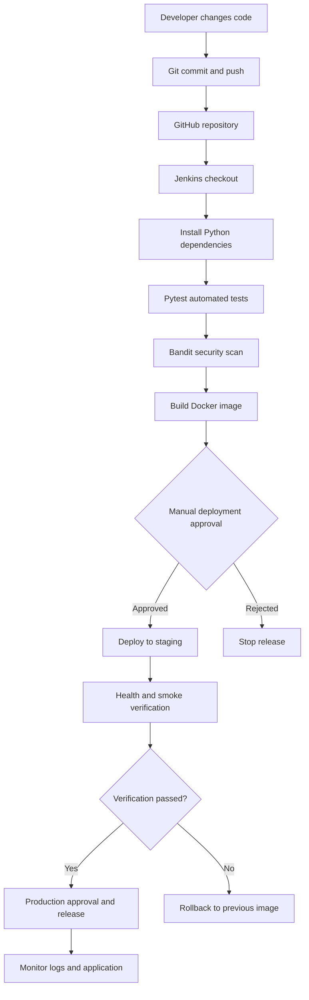

# CI/CD Pipeline Diagram

## Stage explanation
1. SCM: Git and GitHub preserve source history and trigger pipeline execution.
2. Build: Jenkins installs pinned Python dependencies.
3. Test: Pytest validates health endpoint, authentication, authorization and profile update.
4. Quality/security: Bandit checks Python source for common security issues.
5. Package: Docker creates a versioned, portable container image.
6. Deploy: Jenkins deploys an approved image to staging.
7. Verify: health endpoint and smoke tests confirm service readiness.
8. Release/rollback: production approval is separate; previous image tag and database backup are retained for recovery.
